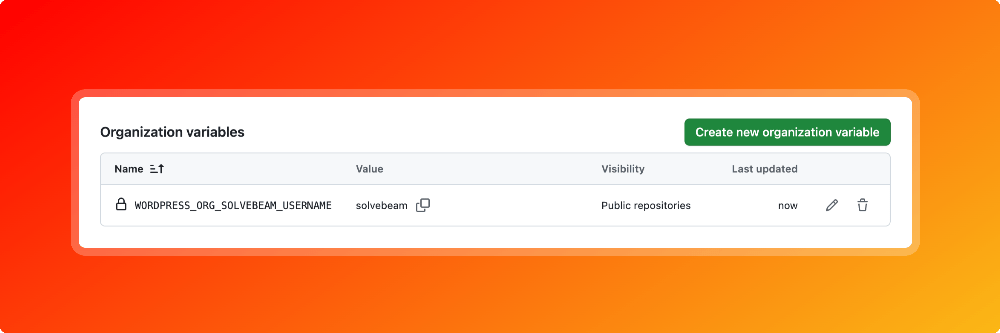
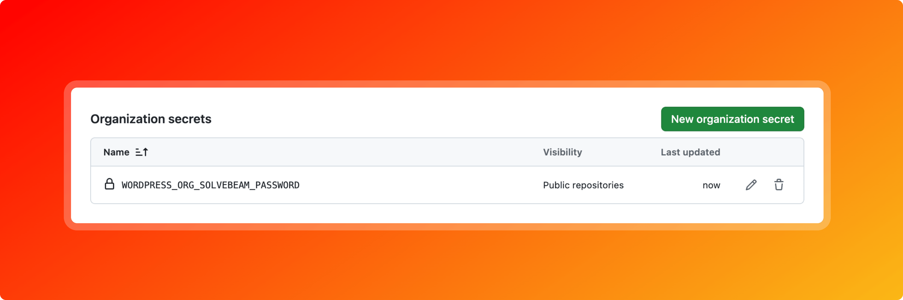
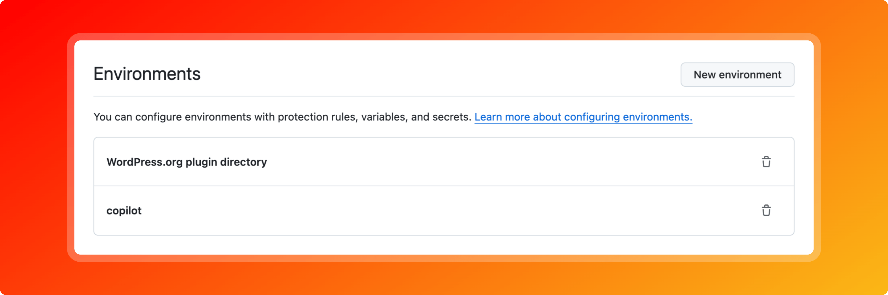
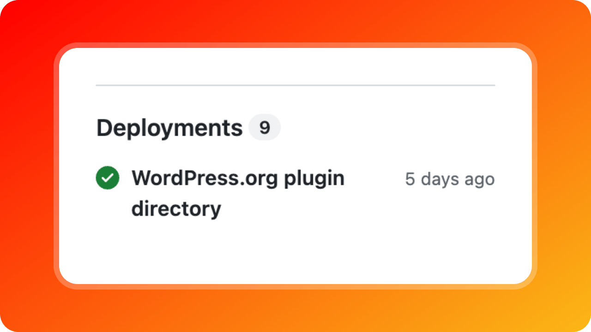
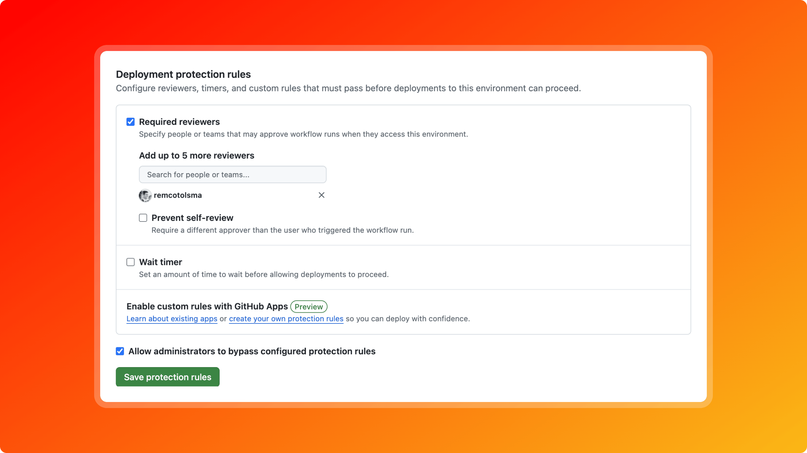

# WordPress.org plugin deploy

**Ship the exact ZIP you released, nothing more and nothing less.**

Publish a GitHub release, attach your plugin ZIP, and this action puts *that very ZIP* in the WordPress.org plugin directory. No rebuilding, no `.distignore` guesswork, no surprise files in SVN. What you tested is what your users get.

```
GitHub release v1.2.3 ──► solvebeam-diagrams-with-mermaid.1.2.3.zip ──► ✅ checks ──► trunk + tags/1.2.3 on WordPress.org
```

## Why this action?

Most WordPress.org deploy actions, including the popular [10up/action-wordpress-plugin-deploy](https://github.com/10up/action-wordpress-plugin-deploy), check out your repository and put the plugin together again at deploy time, using `.distignore` or `.gitattributes` rules. That means the files on WordPress.org can differ from the ZIP you released and tested. This action takes the opposite approach:

- 📦 **Release-artifact based.** It deploys the `{slug}.{version}.zip` asset from your GitHub release, the same file your users can download from GitHub. One build and one source of truth.
- 🛡️ **Fails loudly, never quietly.** Before touching SVN it checks that the release exists, that the ZIP contains `readme.txt` and that the `Stable tag` matches the release version. If the SVN tag already exists, the run fails with a clear message instead of turning green while doing nothing.
- 🔁 **Redeploy any tag with one click.** Thanks to `workflow_dispatch`, you can (re)deploy any existing release from the GitHub UI. No tag-push tricks needed.
- 🚦 **Made for GitHub Environments.** Treat WordPress.org as a real deployment target: see deployments on your repository homepage and require approval before anything goes live.
- 🧹 **No side effects in your repository.** No `actions/checkout`, no build step, no temporary git commits by a bot user in your workspace.
- 🐘 **Written in PHP, for WordPress developers.** The deploy logic is a readable PHP script instead of a bash script, so it's easy to understand, debug and contribute to.
- 📋 **Tidy logs.** Every step runs in its own collapsible log group, so you can see right away where something went wrong.
- 🧾 **Job summary.** Every run writes a summary with the result, links to the GitHub release, the plugin page, Subversion and Trac, a table of the Subversion changes and the commands that were run.
- 🧪 **Dry run.** With `dry-run: true` every step and check runs as usual, but the Subversion commit and tag commands are only printed, not executed.
- 🖼️ **Handles tricky filenames.** Files like `icon@2x.png` just work (no Subversion peg revision errors).

### Compared to 10up/action-wordpress-plugin-deploy

| | This action | 10up |
|---|---|---|
| What gets deployed | The ZIP attached to your GitHub release | A fresh copy of your repository, filtered by `.distignore` / `.gitattributes` |
| Needs checkout and build steps in the workflow | No | Yes |
| Checks `Stable tag` against the release version | ✅ Yes | ❌ No |
| Version already on WordPress.org | ✅ Fails with a clear error | ❌ Exits green without deploying |
| Redeploy an existing release from the UI | ✅ Built in (`workflow_dispatch` + `tag`) | Needs extra configuration |
| Job summary with links and Subversion changes | ✅ Yes | ❌ No |
| Credentials | Action inputs (`username` / `password`) | Environment variables (`SVN_USERNAME` / `SVN_PASSWORD`) |
| Dry run | ✅ Yes | ✅ Yes |

To update the `readme.txt` and `assets` directory on WordPress.org without a new release, use the companion action [solvebeam/action-wordpress-org-plugin-readme-deploy](https://github.com/solvebeam/action-wordpress-org-plugin-readme-deploy).

**In short:** if you want your WordPress.org release to be the same artifact as your GitHub release, with safeguards that stop mistakes before they hit SVN, this action is for you.

## Usage

This GitHub action can be used to automatically deploy a WordPress plugin to the WordPress.org plugin directory whenever a new release is released via GitHub releases. It is important that the GitHub release contains a distribution archive asset with a filename of the `{name}.{version}.zip` format. The [WP-CLI command `wp dist-archive`](https://developer.wordpress.org/cli/commands/dist-archive/) can be used to create a distribution archive with this filename format.

### Actions secrets and variables

For the WordPress.org login details it can be useful to create a variable and secret at organization level. For example, for the organization SolveBeam the following variable and secret are used:

```
${{ vars.WORDPRESS_ORG_SOLVEBEAM_USERNAME }}
```

```
${{ secrets.WORDPRESS_ORG_SOLVEBEAM_PASSWORD }}
```

This way, the WordPress login details can be managed in one place and you don't have to do this per repository or environment.

#### Screenshot of GitHub organization actions variables settings



#### Screenshot of GitHub organization actions secrets settings



### Environments

The WordPress.org plugin directory can be seen as an environment where the plugin in a GitHub repository can be deployed to. The advantage of this is that GitHub shows the deployments to the WordPress.org plugin directory. And with protection rules you can delay the deployment to WordPress.org until after approval by 1 or more GitHub users.

#### Screenshot of GitHub repository environments settings



#### Screenshot of GitHub repository homepage deployments



#### Screenshot of GitHub repository environment deployment protection rules



## Example

```yml
name: Deploy to WordPress.org

on:
  workflow_dispatch:
    inputs:
      tag:
        description: 'Tag to deploy to WordPress.org'
        required: true
        type: string
      dry-run:
        description: 'Dry run, without committing or tagging on WordPress.org'
        required: false
        default: false
        type: boolean
  release:
    types: [released]

jobs:
  deploy:
    runs-on: ubuntu-latest

    environment:
      name: WordPress.org plugin directory
      url: https://wordpress.org/plugins/solvebeam-diagrams-with-mermaid/

    steps:
      - name: Deploy
        uses: solvebeam/action-wordpress-org-plugin-deploy@v1
        env:
          GITHUB_TOKEN: ${{ secrets.GITHUB_TOKEN }}
        with:
          username: ${{ vars.WORDPRESS_ORG_SOLVEBEAM_USERNAME }}
          password: ${{ secrets.WORDPRESS_ORG_SOLVEBEAM_PASSWORD }}
          tag: ${{ inputs.tag || github.event.release.tag_name }}
          slug: solvebeam-diagrams-with-mermaid
          dry-run: ${{ inputs.dry-run || false }}
```

### Versions

This action follows [Semantic Versioning](https://semver.org/). The `v1` tag always points to the latest `1.x.x` release, so you get fixes and new features without breaking changes. Prefer full control? Pin an exact release such as `@v1.0.0`, or a commit SHA. See the [changelog](CHANGELOG.md) for what changed.

### Inputs

| Input | Required | Description |
| --- | --- | --- |
| `username` | Yes | WordPress.org Subversion username, case sensitive. |
| `password` | Yes | WordPress.org Subversion password. |
| `tag` | Yes | Release tag name, with or without a leading `v`. The GitHub release must contain a `{slug}.{version}.zip` asset. |
| `slug` | Yes | WordPress.org plugin slug, for example `solvebeam-diagrams-with-mermaid`. |
| `dry-run` | No | `true` to run every step except the Subversion commit and tag. Defaults to `false`. |

## In the wild

- [solvebeam/solvebeam-diagrams-with-mermaid-for-wordpress](https://github.com/solvebeam/solvebeam-diagrams-with-mermaid-for-wordpress) ([workflow](https://github.com/solvebeam/solvebeam-diagrams-with-mermaid-for-wordpress/blob/main/.github/workflows/deploy-to-wordpress-org.yml))

Using this action in your plugin? Open a pull request to add it to this list.

## Related

- https://github.com/solvebeam/action-wordpress-org-plugin-readme-deploy: deploy `readme.txt` and `assets` changes to WordPress.org without a new release.

## Inspiration

- https://github.com/marketplace/actions/wordpress-plugin-svn-deploy
  - https://github.com/nk-o/action-wordpress-plugin-deploy
- https://github.com/marketplace/actions/wordpress-plugin-readme-assets-update
  - https://github.com/10up/action-wordpress-plugin-asset-update
- https://github.com/marketplace/actions/deploy-to-wordpress-org-svn-repository
  - https://github.com/richard-muvirimi/deploy-wordpress-plugin
- https://github.com/actions/deploy-pages
- https://github.com/actions/upload-pages-artifact

## Development

```
composer install
GITHUB_REPOSITORY=solvebeam/solvebeam-diagrams-with-mermaid php deploy.php
```
